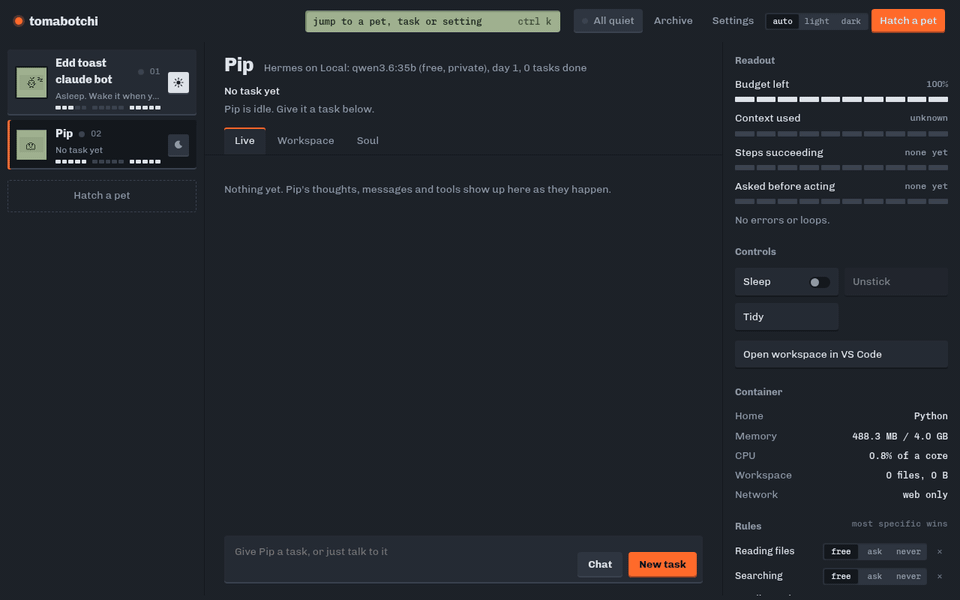
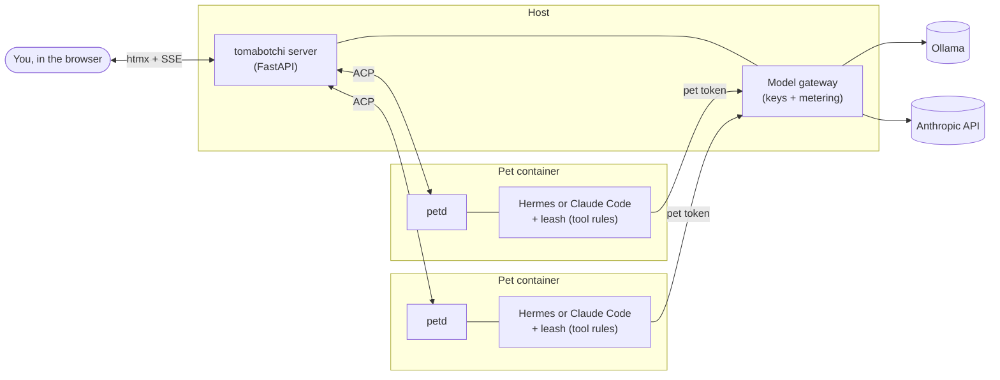

<div align="center">

# 🥚 tomabotchi

**Pocket pets for your AI agents.**

Every agent gets its own sealed Docker container, its own soul, and a spot on a dashboard
where you watch it work, answer its calls for tools from the keyboard, and teach it lessons it keeps.

[](LICENSE)


[Quick start](#quick-start) · [Features](#features) · [How it works](#how-it-works) · [User guide](docs/guide.md) · [Contributing](CONTRIBUTING.md)

</div>

<p align="center">
  
  <br>
  <sub>Pip, a Hermes pet on a local Qwen model, asks before writing a file, gets an <kbd>A</kbd> to approve, and reports back. (Real run, model wait sped up.)</sub>
</p>

## Why?

> *"I start a few agents and then lose track of them. An hour later I find one has been sitting there
> the whole time waiting for me to OK a tool. Another has been retrying the same failed search over and over.
> To find out what any of them is thinking I have to dig through terminals. And each one's personality and
> rules live in a prompt file I never get round to updating, even after it does something I didn't like."*

tomabotchi gives each agent a home and a face, and puts all of them on one screen. A pet that needs you
**beeps and wobbles** until you answer. A stuck pet **looks sick**. When you say no and tell it why,
**the lesson is written into its soul** so it doesn't make the same mistake twice. And nobody dies: retired pets
rest on the memory shelf with a backup of everything they made.

## Features

- 🏠 **One sealed container per pet.** Each agent runs in its own Docker home (Python, data tools, Node, a browser, or your own image) with CPU, memory and process limits, on its own network. One pet can't touch another.
- 🧠 **Pick the brain and the model.** [Hermes](https://github.com/NousResearch/hermes-agent) or Claude Code, on a local Ollama model or Claude, chosen per pet. You can switch a pet's model later without re-hatching it.
- 🔑 **Your API key stays put.** Pets only see their own gateway token. The server's gateway swaps in the real key and meters usage.
- ⏱️ **A live, shared timeline.** Thoughts, messages and tool calls stream in as blocks. Failures show red, loops get bracketed, and a call waiting on you grows orange until you answer.
- ⌨️ **Keyboard-first approvals.** `A` approves once, `Shift A` always (it adds a narrow rule), `D` denies. `N` jumps to whichever pet has waited longest, and `Ctrl K` opens the command palette.
- 📜 **Rules you can see.** Every tool or folder is *free*, *ask* or *never*, per pet, and you can flip them with one click.
- 🌱 **Souls and lessons.** Each pet has a `SOUL.md` or `CLAUDE.md`. Denials with a reason, praise and scolding become lessons it uses from its next task.
- 🧩 **Skill store.** Install skills into a pet's brain from the built-in store, a `.zip`, a `SKILL.md` or a GitHub folder.
- 🧑‍💻 **VS Code in the page.** Open a pet's workspace in the browser to review or change what it built.
- 📚 **Full history.** Every task and chat keeps its transcript, which you can export to Markdown.
- 👾 **Every pet is unique.** Each pet's pixel face is randomly drawn at hatch time, with scenes for working, calling, stuck and asleep.
- 🎭 **Practice mode.** A scripted brain that needs no Docker and no model, so you can try the UI in seconds.

## Quick start

**You need:** Docker. For local models you also need [Ollama](https://ollama.com) on the host (or let compose run one for you, as described in the [guide](docs/guide.md#no-ollama-on-the-host)).

```bash
git clone https://github.com/Thood42/tomabotchi.git
cd tomabotchi
cp .env.example .env          # optional: add ANTHROPIC_API_KEY for Claude models
ollama pull qwen3.6:35b       # the default local model
docker compose up -d --build  # or: bin/tomabotchi up
```

Open **http://127.0.0.1:8770** (it listens on localhost only) and click **Hatch a pet**.

The first hatch on a home builds the pet runtime image, which takes a few minutes. Later hatches take seconds.

```bash
bin/tomabotchi logs     # follow the server log
bin/tomabotchi ps       # the server and the pets' containers
docker compose down     # stop the server (pets keep running, and it reattaches when you start it again)
```

> **Just want to look around?** Hatch a pet with the **practice brain**. It plays a script, with no model
> needed. Put `#sick` in a task to see a stuck pet, or `#slow` for a long one.

## How it works



- The **server** runs in its own container, manages the pets through the Docker socket, and serves the dashboard.
- Inside each pet, **petd** runs the agent and speaks [ACP](https://agentclientprotocol.com) to the server.
- The **leash** (a Hermes plugin or a Claude Code hook) checks each tool call against the pet's rules: *free* goes ahead, *ask* becomes a call on your dashboard, and *never* is refused.
- Model traffic goes through the **gateway**, so pets never hold a real API key.

## How pet care maps to agent care

| On the toy | In tomabotchi |
|---|---|
| Attention beep | The pet needs a decision from you: a tool approval or a question |
| Feed | Give it a task |
| Energy | Budget left (tokens, time) for the current task |
| Sick skull | Errors or loops: a stuck pet |
| Medicine | **Unstick**: stop the turn and nudge it to try another way |
| Lights off | **Sleep** pauses the whole container |
| Discipline | Praise or scold. Both write a lesson into its soul |
| The toy dies | Nobody dies. Retired pets go to the memory shelf, with their soul and a zip of everything they made |

## Documentation

- **[User guide](docs/guide.md)**: the interface, keyboard shortcuts, daily tasks, and configuration
- **[Contributing](CONTRIBUTING.md)**: development setup, tests, and code layout
- **[Planning docs](docs/plans/)**: the product, architecture and design notes from the original build

## Contributing

Issues and pull requests are welcome. See [CONTRIBUTING.md](CONTRIBUTING.md). If you like the idea,
a ⭐ on the repo helps other people find it.

## License

[MIT](LICENSE) © 2026 Trevor Hood.

Bundled third-party assets keep their own licenses: htmx and idiomorph (BSD), and the Chivo fonts (SIL OFL).
See [`src/tomabotchi/static/vendor/`](src/tomabotchi/static/vendor/).
